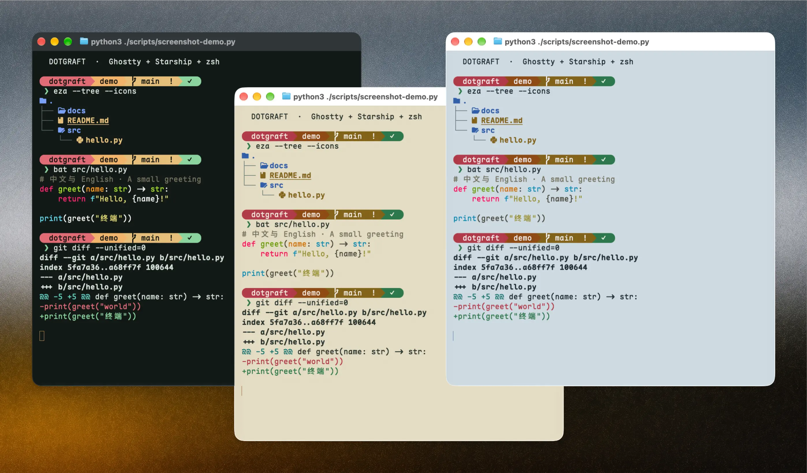

# Dotgraft

[English](README.md) · 简体中文

Dotgraft 是一套由 [chezmoi](https://www.chezmoi.io) 管理的 macOS 终端配置：**Ghostty + Starship + zsh**。配置是版本化的文件，安装前可以预览，更新时可以查看差异，卸载前会先备份。



## 快速开始

```bash
bash <(curl -fsSL https://raw.githubusercontent.com/rokcso/dotgraft/main/bootstrap.sh)
```

脚本会检查环境、安装 chezmoi、询问三个选配问题、展示 diff，确认后才写入。

<details>
<summary>固定 release / 非交互安装</summary>

固定 release：

```bash
DOTGRAFT_REF=v0.1.0 \
  bash <(curl -fsSL https://raw.githubusercontent.com/rokcso/dotgraft/v0.1.0/bootstrap.sh)
```

`DOTGRAFT_REF` 会让 `chezmoi init` checkout 对应 tag；release 安装的 source 固定在 tag，日常 `dotgraft update` 不会跨版本更新。

非交互安装：

```bash
DOTGRAFT_YES=1 \
DOTGRAFT_TOOLS="fzf,zoxide,eza,bat,yazi" \
DOTGRAFT_THEME="Dotgraft Ink" \
DOTGRAFT_GLASS=true \
  bash <(curl -fsSL https://raw.githubusercontent.com/rokcso/dotgraft/main/bootstrap.sh)
```

也可以传参：`bootstrap.sh --yes --tools=fzf,zoxide --theme="Dotgraft Paper" --glass=false`。

</details>

## 特点

- **幂等**：`dotgraft apply` 跑多次结果一致。
- **先看后改**：`dotgraft diff` 默认只列文件摘要，`--full` 才看逐行补丁。
- **可更新**：`dotgraft update` 拉取上游、预览、应用，并修复依赖。
- **独立 source**：使用 `~/.local/share/chezmoi-dotgraft` 和 `~/.config/dotgraft/chezmoi.toml`，不写入默认 chezmoi 配置。
- **可撤销**：卸载前备份受管文件和已有配置；不完整的 `.zshrc` 区块会被拒绝处理。

## 常用命令

| 命令 | 作用 |
|---|---|
| `dotgraft status` | 当前选配、文件差异和版本 |
| `dotgraft diff [--full]` | 查看将要发生的改动 |
| `dotgraft apply` | 预览、确认、应用 |
| `dotgraft update` | 拉取上游、预览、应用并修复依赖 |
| `dotgraft reconfigure` | 重新选配 |
| `dotgraft theme [ink\|paper\|porcelain\|list]` | 切换 Ghostty + Starship 主题 |
| `dotgraft backup list` | 查看备份 |
| `dotgraft restore <时间戳>` | 从备份恢复 |
| `dotgraft doctor` | Dotgraft 环境自检 |
| `dotgraft uninstall` | 备份后卸载 |

完整命令、备份恢复和卸载边界见 [使用与维护](docs/usage.md)。安装后还会得到 `dotg` 短别名。

## 主题

三套内置主题：

- **Dotgraft Ink**：深色，默认
- **Dotgraft Paper**：浅色暖光
- **Dotgraft Porcelain**：浅色冷光

```bash
dotgraft theme            # 当前主题和可选主题
dotgraft theme paper      # 切换
```

Starship 会自动使用对应调色板。配色、对比度和切换细节见 [Themes](docs/themes.md)。

## 文件与安全

- 不需要 `sudo`，不改 `/etc`，不修改 `~/.zprofile` 和 `~/.zshenv`。
- `~/.zshrc` 只增加一小段标记区块；其余配置在 `~/.config/zsh/`、`~/.config/ghostty/`、`~/.config/starship.toml` 和 `~/.local/bin/dotgraft`。
- 安装和卸载前会备份到 `~/.config-backup/<时间戳>/`。
- 默认的 `~/.local/share/chezmoi` 和 `~/.config/chezmoi/` 不会被写入。

完整的文件落点和卸载安全边界见 [使用与维护](docs/usage.md)。

## 文档

| 文档 | 内容 |
|---|---|
| [使用与维护](docs/usage.md) | 日常命令、选配、备份恢复、卸载、本地开发 |
| [配置架构](docs/configuration.md) | 仓库结构、chezmoi 属性、片段顺序、扩展方式 |
| [Ghostty](docs/ghostty.md) | 配置项、macOS 覆盖文件、快捷键、验证 |
| [Themes](docs/themes.md) | 三套主题、角色、对比度、Starship 联动 |
| [Shell](docs/shell.md) | Starship、插件、CLI 工具、别名与补全 |
| [排错](docs/troubleshooting.md) | 常见问题和诊断命令 |
| [Changelog](CHANGELOG.md) | 版本变更 |

## 环境要求

- macOS 13 及以上（Apple Silicon / Intel）
- [Homebrew](https://brew.sh)
- [Ghostty](https://ghostty.org) 1.3 及以上
- 原生毛玻璃需要 macOS 26 及以上；更旧的系统使用数字模糊
- 首次安装需要网络

## 状态

当前版本见 `VERSION` 和 [CHANGELOG.md](CHANGELOG.md)。

已支持安装、更新、选配、备份恢复、卸载和独立 chezmoi source。CI 覆盖 shell 静态检查、主题契约、bats 单元测试和 macOS 14 / latest 的 smoke 测试；打 tag 后，release workflow 会先在 macOS 跑完整测试，再创建 release。

暂不支持 Linux：Ghostty 安装方式、字体路径和部分配置项不同，仓库没有可验证的 Linux 环境。

## 致谢

[Ghostty](https://ghostty.org) · [Starship](https://starship.rs) · [chezmoi](https://www.chezmoi.io) · [Maple Mono NF](https://github.com/subframe7536/maple-font) · [Catppuccin](https://github.com/catppuccin/catppuccin) · [zsh-autosuggestions](https://github.com/zsh-users/zsh-autosuggestions) / [zsh-syntax-highlighting](https://github.com/zsh-users/zsh-syntax-highlighting) / [zsh-completions](https://github.com/zsh-users/zsh-completions)

## 许可

[MIT](./LICENSE)
